# 🎥 Video de la práctica: https://youtu.be/_fSGHhyh1P4

# Segundo Parcial: Infraestructura de red, servicios y hardening CIS

**Asignatura:** Seguridad de redes  · **Estudiante:** Lisbeth Gómez · **Matrícula:** 2025-0701 · **Fecha:** 13/11/2026

## 1. Propósito

Construir en GNS3 una LAN con un router Cisco, un switch Cisco IOSvL2, una PC de usuario, un Windows Server (Active Directory y NPS) y un servidor Zabbix en Linux. Sobre ella se implementan: hardening CIS automatizado por script, port-security, AAA solo en consola y auxiliar, DHCP, SNMP de solo lectura y acceso administrativo por SSH.

## 2. Topología

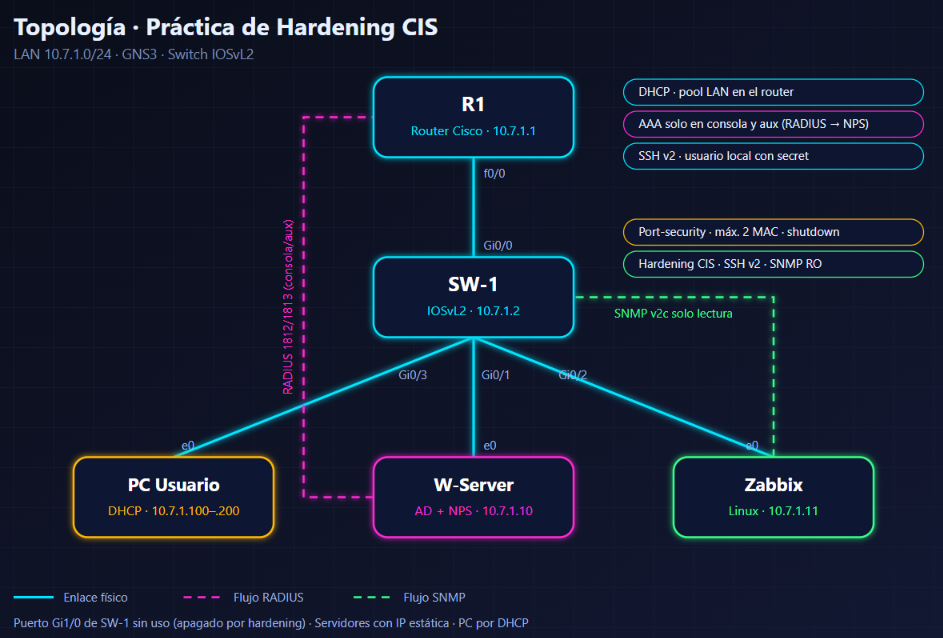

Red LAN: `10.7.1.0/24`

| Equipo | Rol | Interfaz | IP |
|---|---|---|---|
| R1 | Router Cisco, DHCP, AAA | f0/0 | 10.7.1.1/24 |
| SW-1 | Switch IOSvL2 | Vlan1 | 10.7.1.2/24 |
| W-Server | Windows Server (AD + NPS) | e0 | 10.7.1.10 (estática) |
| Zabbix | Servidor Linux | e0 | 10.7.1.11 (estática) |
| PC Usuario | Cliente | e0 | DHCP (10.7.1.100 a .200) |

Conexiones: R1 f0/0 ↔ SW-1 Gi0/0 · W-Server ↔ SW-1 Gi0/1 · Zabbix ↔ SW-1 Gi0/2 · PC ↔ SW-1 Gi0/3 · Gi1/0 sin uso (apagado).

### Diagrama lógico

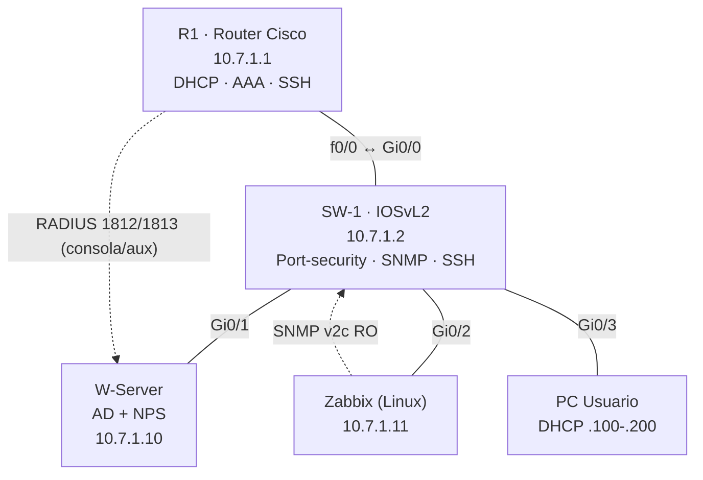

### Flujo de autenticación AAA (solo consola y auxiliar)

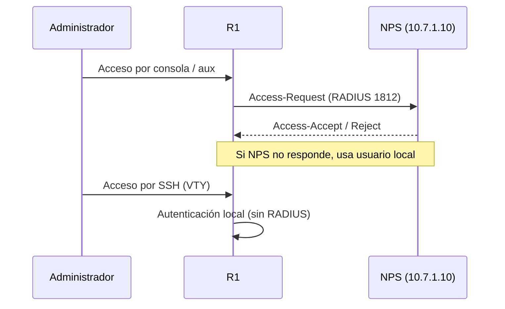

### Flujo de despliegue del hardening

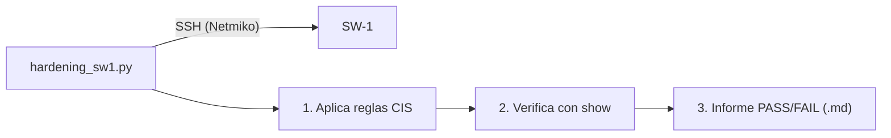

## 3. Estructura del repositorio

```
.
├── README.md
├── requirements.txt
├── configs/
│   ├── R1.cfg
│   └── SW-1.cfg
├── scripts/
│   └── hardening_sw1.py
└── images/
    └── (evidencias y diagrama)
```

## 4. Implementación y evidencias

### 4.1 Script de hardening (2 pts)

`scripts/hardening_sw1.py` se conecta por SSH al switch con Netmiko, pide la contraseña y el enable por `getpass` (no quedan en el código), aplica las reglas CIS elegidas, las verifica con `show` y genera un informe `informe_hardening_<fecha>.md` con PASS/FAIL por regla.

Reglas aplicadas: cifrado de contraseñas, enable secret, HTTP deshabilitado, PAD y BOOTP deshabilitados, sin DNS lookup, CDP deshabilitado, timestamps y logging, banner, bloqueo por intentos fallidos, SSH v2, VTY solo SSH con timeout, consola con timeout y puertos sin uso apagados.


### 4.2 Repositorio (1 pt)

README con el enlace del video al inicio, un archivo de configuración por equipo en `configs/` y evidencias en `images/`.

### 4.3 Direccionamiento y conectividad (1 pt)

Direccionamiento `10.7.1.0/24`, hostname en todos los equipos y conectividad entre los equipos de la LAN.

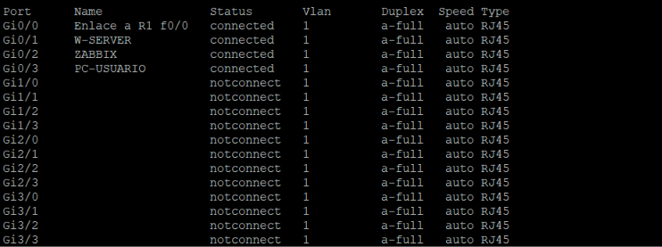
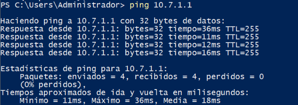
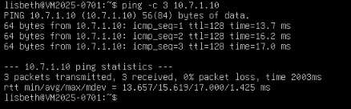

### 4.4 Port-security (1 pt)

Configurado en Gi0/3 (puerto de la PC de usuario): máximo 2 MAC, violación `shutdown`, MAC sticky. Los puertos de los servidores (Gi0/1 y Gi0/2) son VMs de VMware que emiten MAC adicionales, por lo que el port-security se aplicó en el puerto de usuarios.

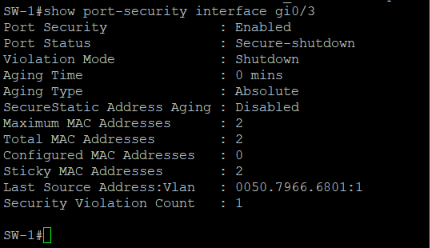


### 4.5 AAA solo en consola y auxiliar (2 pts)

`aaa authentication login CON-AUX group NPS-GRP local` y `aaa authorization exec CON-AUX group NPS-GRP local`, aplicados únicamente a `line con 0` y `line aux 0`. Las líneas VTY usan la lista `default` (local).

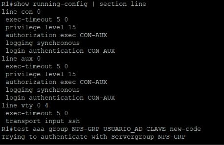
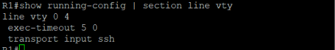

### 4.6 DHCP (1 pt)

Servidor DHCP en R1, pool `LAN` con exclusiones `.1-.99` y `.201-.254`, gateway `10.7.1.1` y DNS `10.7.1.10`.

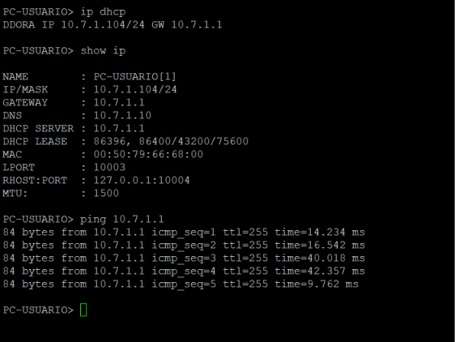

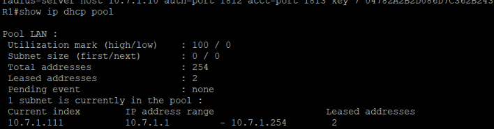
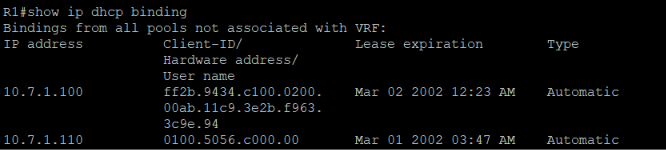

### 4.7 SNMP en el switch (1 pt)

Comunidad SNMP de solo lectura en SW-1, restringida por ACL 10 al servidor Zabbix (`10.7.1.11`).


### 4.8 Acceso administrativo por SSH (1 pt)

Usuario local con `secret`, SSH v2 y `transport input ssh` (sin Telnet) en R1 y SW-1.

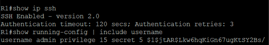
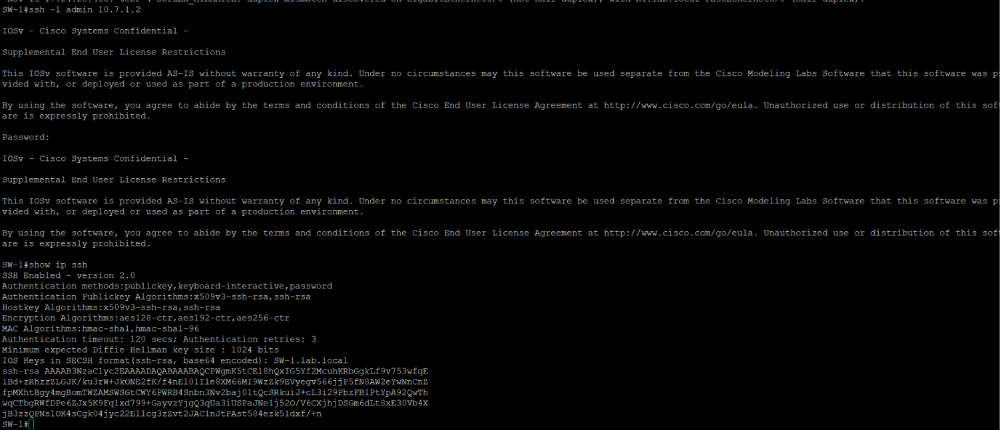

## 5. Notas

- Las credenciales en `configs/` están como `CAMBIAR_*` y no se publican valores reales.
- Los servidores usan IP estática y la PC recibe su dirección por DHCP.
